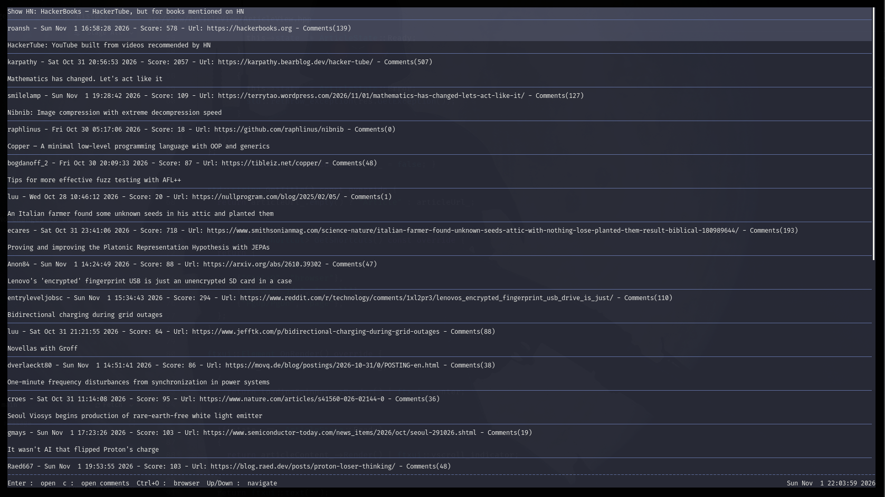
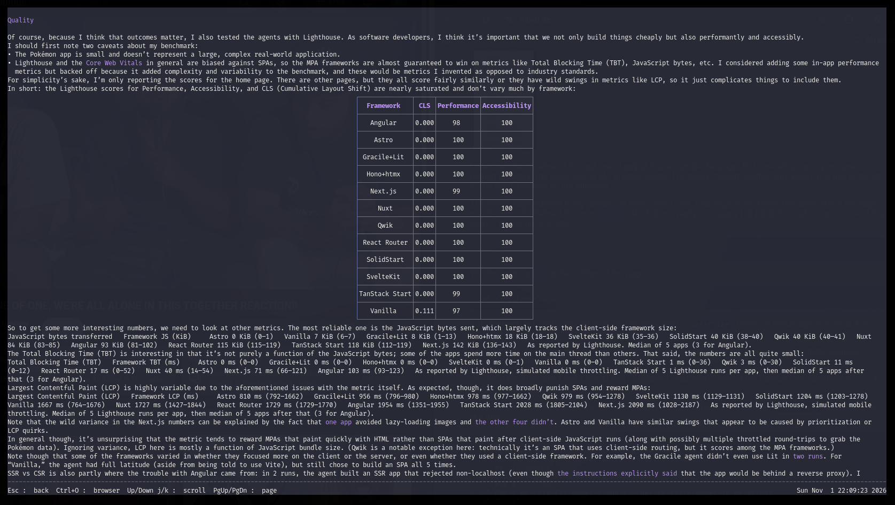
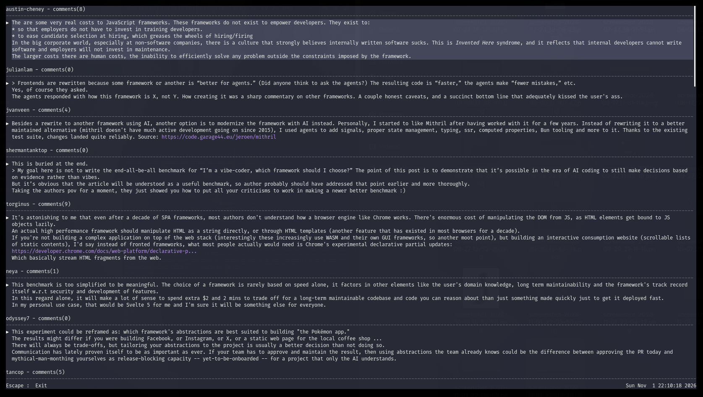

# hn-reader

A terminal reader for Hacker News, written in C++20 with [FTXUI](https://github.com/ArthurSonzogni/FTXUI).


> NOTE: this is a personal project so it is not actively maintained also 
some features where not tested in all operating systems (MAC especially)

## Features

- Browse the current top stories from the Hacker News API
- Read articles in the terminal or in a browser
- Browse comment threads
- Render images inside the terminal (requires ImageMagick or GraphicsMagick)
- Multiple built-in themes and support for custom themes


### Article List


### Article Example


### User Commets


### Image Example


## Limitations

- videos, giffs and pdf are not supported
- some websites posted on hacker news may not be rendered correctly
- coding section in articles most of the time are not rendered correctly doe to the fact
  that are not embedded in real coding sections so are treated as regular text
- in image-heavy websites so lag may be experienced
- strange HTML combinations are not rendered correctly

## Requirements

- CMake 3.14 or newer
- A C++20 compiler
- Git and network access during the first configure (dependencies are downloaded by CMake)
- ImageMagick or GraphicsMagick (optional; needed to render article images)

On Windows, you must use the same compiler toolchain that this project's CMake
build is configured with: the MSYS2 UCRT64 MinGW-w64
`g++` compiler with the `MinGW Makefiles` generator. Other compilers and
toolchains (MSVC, other MinGW variants, Clang) are not supported.

### Dependencies

The following dependencies are fetched automatically by `CMakeLists.txt`:

- FTXUI 7.0.0
- ftxui-image-view-async
- nlohmann/json 3.12.0
- curl 8.21.0
- lexbor 3.0.0

## Build

```sh
cmake --build build 
```

## Run

```sh
./build/hn-reader
```

## Debugging the article scraper

The `harness` target is a small standalone tool used to debug
`ArticleScraper` without launching the full TUI. It fetches the page
with `curl`, runs it through the scraper pipeline with debug logging
enabled, and prints the scraper logs to stdout (progress and errors go
to stderr).

```sh
./build/harness "<url>"
```

The `harness-article` target renders the same scrape result in a full
terminal UI by reusing the app's real `ArticleView` (scrolling, Esc to
exit, Ctrl+O to open the url in a browser), so it is useful to debug
the rendered output rather than the scraper pipeline. Scraping runs
synchronously before the UI starts; a failed scrape is reported on
stderr and the tool exits.

```sh
./build/harness-article "<url>"
```

## Image support

Article images are rendered with `ftxui-image-view-async`, which decodes images
with CImg.

By default this project builds CImg without its native libjpeg/libpng backends.
For JPEG/PNG and most other formats, CImg therefore delegates decoding to an
external ImageMagick or GraphicsMagick binary. If neither is available, the app
still runs, but article images will not render.

- ImageMagick (recommended):
  - Debian/Ubuntu: `sudo apt install imagemagick`
  - Fedora: `sudo dnf install ImageMagick`
  - Arch: `sudo pacman -S imagemagick`
  - macOS: `brew install imagemagick`
  - Windows: `winget install ImageMagick.ImageMagick` (ImageMagick 7; make sure
    `magick.exe` is on `PATH`)
- GraphicsMagick (`gm`) can be used instead.

Remote image URLs are downloaded with `curl`, then `wget` (PowerShell is also
tried on Windows). `curl` ships with Windows 10+ and is normally available on
Linux/macOS.

### Native libjpeg/libpng support

Instead of relying on ImageMagick at runtime, CImg can decode JPEG/PNG natively.
Define `cimg_use_jpeg` and/or `cimg_use_png` when compiling
`ftxui-image-view`, and link the corresponding libjpeg/libpng libraries (libpng
also requires zlib). This project does not enable those flags by default. If
only one is enabled, the other format still falls back to ImageMagick or
GraphicsMagick. GIF always requires one of those external tools.

## Keybindings

| Key | Action |
| --- | --- |
| `Up` / `Down` | Navigate the story list |
| `Enter` | Open the selected article |
| `c` | Open the comments for the selected story |
| `Ctrl+O` | Open the current article in a browser |
| `Ctrl+T` | Open the theme menu |
| `Up` / `Down`, `j` / `k` | Scroll the article |
| `PgUp` / `PgDn` | Scroll one page |
| `Home` / `End` | Jump to the start or end |
| `Esc` | Go back |

## Themes

Press `Ctrl+T` to switch between the built-in themes:

`hn light`, `hn dark`, `dracula`, `solarized dark`, `solarized light`,
`ashen`, `rose pine`, `rose pine dawn`.

Custom themes are JSON files placed in the configuration directory:

- Linux: `$XDG_CONFIG_HOME/hn-reader/themes` or `~/.config/hn-reader/themes`
- Windows: `%APPDATA%\hn-reader\themes`

See [`themes/color_scheme.json`](themes/color_scheme.json) for the expected format.

## How Does It Work?

Content of the [Hacker News](https://news.ycombinator.com/) website is fetched throug their official APIs https://github.com/hackernews/api.

Articles are fetch using the link returned by the APIs. The main content is extracted using a port of the [Mozilla Redability algorith](https://github.com/mozilla/readability) ported in C++ using [lexbor](https://lexbor.com/) as HTML DOM helper.

The resulting HTML is parsed again and converted to a minimalistic subset of HTML used then in the [ftxui](https://github.com/ArthurSonzogni/FTXUI) framework to format the article to make it more readable than plain text.

The same procedure, with the exception of content extraction, is used for rendering comments from the users.

## License

Original code in this repository is licensed under the [MIT License](LICENSE).

Portions of the project are based on third-party code and remain under their
original licenses:

- MarkdownFTXUI — MIT
- FTXUI — MIT
- Mozilla Readability — Apache-2.0

See [THIRD-PARTY-NOTICES.md](THIRD-PARTY-NOTICES.md) for the full notices and
[LICENSES/Apache-2.0.txt](LICENSES/Apache-2.0.txt) for the Apache License 2.0
text.
